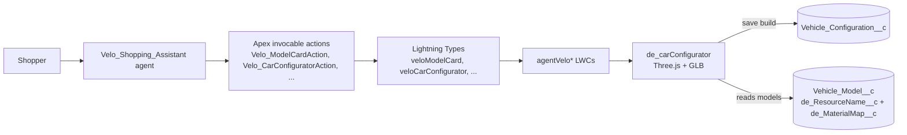

# drive-design

A conversational car-shopping and 3D configurator agent for Agentforce, built for a fictional brand, **Velo Motors**. Shoppers browse models, compare them, customise paint and wheels on a live 3D car, add accessories, find dealers and book a test drive. All of it happens as rich cards inside the chat.

## What it does

**Module 1: the shopping agent (the core of the repo)**

- The `Velo_Shopping_Assistant` agent (web chat) and `Velo_Shopping_Assistant_WA` (WhatsApp variant) call Apex invocable actions. Each action returns data rendered by a custom Lightning Type and an `agentVelo*` LWC, so the answers show up as cards, not plain text.
- Model card, side-by-side model comparison, accessories catalog with in-chat add-to-cart, booking options (colour and trim), dealer list, and a 3D car configurator card.
- `de_carConfigurator` is a Three.js (GLB) configurator. It supports orbit view, body paint, dual-tone roof, gloss/matte, wheel finish, caliper colour, glass tint, interior and day/night lights. Materials are mapped per model with the JSON field `Vehicle_Model__c.de_MaterialMap__c` (role to glTF material-name substrings). Saved builds go to `Vehicle_Configuration__c`.

**Module 2: dealer marketing hub and 360 views (optional, documented separately)**

A second set of LWCs and controllers for a dealer or partner marketing hub: campaign list and detail, content marketplace, quick-send messaging, Lead 360, Customer 360, Vehicle 360, Dealer 360 and a Data Cloud home. This module is a showcase and has these dependencies:

- The Customer/Vehicle/Dealer 360 controllers and `VeloHomeController` query **Data Cloud** DMOs and Calculated Insights that are not part of this repo. They will not return data until you map equivalent objects.
- The hub components target `lightningCommunity__*`, but the Experience Cloud site exports were removed because they were org-specific. Add the components to your own site, or use the included tabs and flexipage in Lightning Experience.
- Much of the hub data (campaigns, messages, lead history) is static demo data.

If you only care about the agent, you can ignore module 2. Nothing in module 1 depends on it.

## Architecture



## Components

| Area | Components | Purpose |
|---|---|---|
| Agent | `bots/`, `genAiPlannerBundles/Velo_Shopping_Assistant_v10`, `aiAuthoringBundles/Velo_Shopping_Assistant` | Web shopping assistant (latest version only) |
| Agent (WhatsApp) | `Velo_Shopping_Assistant_WA` (bot, planner v1, authoring bundle) | Shorter, text-first variant for WhatsApp |
| Apex actions | `Velo_ModelCardAction`, `Velo_ModelComparisonAction`, `Velo_AccessoriesAction`, `Velo_BookingOptionsAction`, `Velo_DealerListAction`, `Velo_CarConfiguratorAction` (+ Info/Response/Item DTOs) | Invocable actions with fictional demo data |
| Lightning Types | `veloModelCard`, `veloModelComparison`, `veloAccessories`, `veloBookingOptions`, `veloDealerList`, `veloCarConfigurator` | Bind action output to the card LWCs |
| Agent LWCs | `agentVeloModelCard`, `agentVeloModelComparison`, `agentVeloAccessories`, `agentVeloBookingOptions`, `agentVeloDealerList`, `agentVeloCarConfigurator` | Chat cards |
| Configurator | `de_carConfigurator`, `de_CarConfiguratorController`, `Vehicle_Model__c`, `Vehicle_Configuration__c`, `scripts/seed_vehicles.apex` | 3D configurator and persistence |
| Module 2 | `de_dealer360`, `de_vehicle360`, `veloCustomer360`, `veloDataCloudHome`, `de_lead360*`, `de_campaign*`, `de_contentMarketplace`, `de_quickSend*`, `de_marketingHubHero`, ... | Dealer marketing hub and 360 views |
| Static resources | `de_three`, `de_threeLoaders`, `de_dracoDecoder`, `de_env_venice` (Poly Haven CC0 HDRI), placeholder `de_carModel_*.glb`, `veloVehicleImages`, `veloAccessoryImages`, `de_showroom_velo` | 3D runtime and placeholder art |

## Placeholder assets (bring your own)

The original project used real manufacturer imagery and licensed 3D models. None of that is included. These are placeholders:

- `veloVehicleImages/*.svg`, `veloAccessoryImages/*.svg` and `de_showroom_velo.svg` are generated SVGs labelled "Replace with your own licensed imagery".
- `de_carModel_*.glb` (8 files, about 65 KB each) are procedural low-poly cars. Their materials are named `body, roof, glass, rim, tyre, caliper, trim, light, interior`.
- Hero and marketing videos were removed. The video slots in the model card, hub hero and benefits section are hidden or replaced with a static background.

To use your own models, replace a `de_carModel_<name>.glb` static resource, keep the same resource name, and update that model's `de_MaterialMap__c` so the roles match your material names. Only use assets you have rights to.

## Prerequisites

- Salesforce CLI (`sf`), and a Developer Edition or sandbox org with Agentforce enabled.
- Data Cloud, only if you want module 2's 360 views to show live data.

## Setup and deploy

```bash
sf project deploy start --source-dir force-app --target-org <alias>
sf apex run --file scripts/seed_vehicles.apex --target-org <alias>   # seeds Vehicle_Model__c
```

Then:

1. Assign the permission sets `Velo_Shopping_Assistant_Cards` and `de_CarConfigurator` (and `DE_360_Tabs` for module 2).
2. Open the agents in Agentforce Builder and activate `Velo_Shopping_Assistant` (and the WA variant if you use it).
3. Optional: add the `de_Car_Configurator` flexipage or tab to an app.

## Configuration

| Item | Where | What to do |
|---|---|---|
| Agent running user | `bots/*/*.bot-meta.xml` `botUser` and `.agent` `default_agent_user` | Currently `replace_me_agent_user@example.com`. Set it to an agent user in your org. |
| Vehicle data | `Vehicle_Model__c` records | Run `scripts/seed_vehicles.apex`, or load your own models. |
| Data Cloud objects | `VeloMotors360Controller`, `de_Vehicle360Controller`, `de_Dealer360Controller`, `VeloHomeController` | Map the DMO and CI names to your own. Module 2 only. |
| CSP Trusted Sites | `cspTrustedSites/` (YouTube, Vidyard) | Optional. Only needed for embedded video. Delete if unused. |

All demo data (dealers, phone numbers, specs, prices) is fictional.

## Screenshots

Add screenshots to `docs/screenshots/`.

## License

MIT. See [LICENSE](LICENSE). The bundled Three.js and its loaders are MIT-licensed by their authors. `de_env_venice.hdr` is a Poly Haven CC0 asset.
